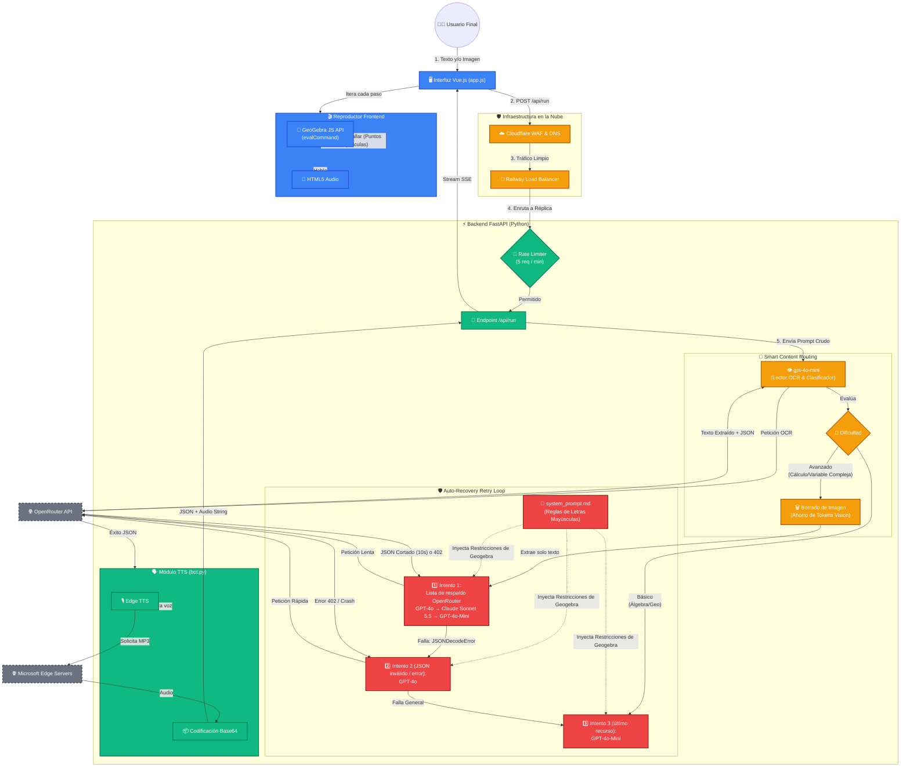
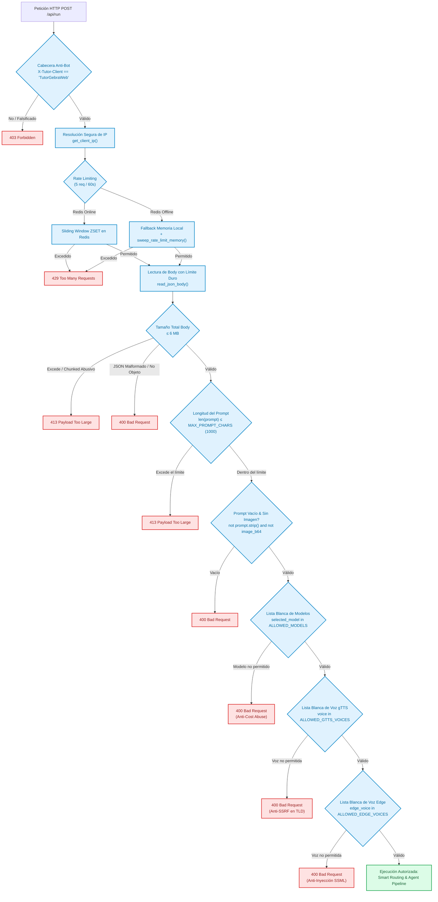
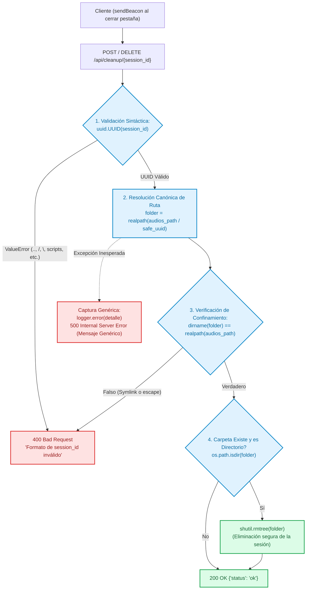

# Flujo de Arquitectura y Ciclo de Vida: TutorGebra AI (v2 - OpenRouter Edition)

Este diagrama ilustra el viaje completo de una petición en TutorGebra, incluyendo la nueva **Gestión de Contenidos Inteligente (Smart Routing)**, el sistema de **Auto-Recuperación de Fallos (Retry Loop)** y la orquestación a través de **OpenRouter**.



## Análisis de los Modelos en la Arquitectura

El sistema de enrutamiento distribuye inteligentemente el tráfico basándose en las fortalezas y debilidades de cada modelo, optimizando los costos de la API de OpenRouter.

**Orden real de intentos (`app/agent.py`):** en modo `auto`, un problema `basic` se resuelve con `gpt-4o-mini`. Un problema `advanced` envía a OpenRouter la lista de respaldo `[gpt-4o, claude-sonnet-5.5, gpt-4o-mini]`, que OpenRouter recorre en ese orden si un proveedor falla. Si la respuesta no es un JSON válido o la llamada da error, el segundo intento fuerza `gpt-4o` y el tercero `gpt-4o-mini`. Si el usuario elige un modelo manualmente, los tres intentos se hacen con ese mismo modelo.

### 1. `gpt-4o-mini` (El Portero y Clasificador)
* **Rol:** Ejecutar OCR (Reconocimiento Óptico de Caracteres), clasificar la dificultad y resolver álgebra clásica.
* **Por qué es bueno:** Es increíblemente rápido y su costo por procesar imágenes es fraccional. Es brillante aislando variables algebraicamente (ej. despejar $y$ en $2x + 3y = 12$) y escribiendo código JSON sin romperlo.
* **Por qué es malo:** Tiene un razonamiento espacial pésimo. Alucina posiciones geométricas, ubica los polos matemáticos en lugares incorrectos y no tiene la profundidad académica para ecuaciones diferenciales o topología.

### 2. `claude-sonnet-5.5` (El Físico Matemático)
* **Rol:** Segundo modelo de la lista de respaldo para problemas universitarios avanzados.
* **Por qué es bueno:** Es el rey indiscutible de la deducción lógica compleja. Puede estructurar lecciones pedagógicas de altísimo nivel.
* **Por qué es malo:** Es muy costoso para procesar visión pesada (lo cual solucionamos extirpando la imagen). En OpenRouter sufre problemas de timeout (10 segundos) que cortan la respuesta JSON a la mitad si se toma demasiado tiempo pensando en problemas largos.

### 3. `gpt-4o` (El Respaldo de Alta Velocidad)
* **Rol:** Modelo primario para problemas avanzados y modelo forzado en el segundo intento.
* **Por qué es bueno:** Tiene una inteligencia académica casi idéntica a Claude, pero transmite (streams) los resultados mucho más rápido a través de OpenRouter, eludiendo eficazmente los bloqueos de 10 segundos.
* **Por qué es malo:** Debido a su vasta base de datos matemáticos, tiene un sesgo inherente hacia la notación matemática estándar (ej. usar $z_1$, $z_2$ minúsculas en Variable Compleja). Esto obligó a la arquitectura a imponer restricciones estrictas en el System Prompt para forzarlo a usar Mayúsculas en los puntos y evitar crashear GeoGebra.

---

## Pipeline de Seguridad, Blindaje y Validación (Zero-Trust)

Para garantizar la estabilidad y proteger la infraestructura en producción (Railway), se implementó una arquitectura de defensa en profundidad orientada a neutralizar vectores de ataque web (Path Traversal, SSRF, saturación de memoria/tokens, bypass de Rate Limiting y fuga de secretos).

### 1. Pipeline de Validación en `/api/run`

Toda solicitud entrante debe superar una serie de compuertas deterministas antes de que se autorice la llamada al agente de inteligencia artificial o a los motores de síntesis de voz.



### 2. Ciclo de Vida y Limpieza Segura de Sesiones (`/api/cleanup/{session_id}`)

Para eliminar de forma segura los audios temporales sin permitir ataques de borrado masivo o transversal de directorios (*Arbitrary File Deletion / Path Traversal*):



### 3. Matriz de Controles y Validaciones Implementadas

| Componente | Vulnerabilidad / Riesgo Mitigado | Mecanismo de Validación |
| :--- | :--- | :--- |
| **Sesiones (`/api/cleanup`)** | Path Traversal / Borrado masivo arbitrario de archivos con secuencias `%2e%2e` o `..`. | Validación estricta `uuid.UUID()` + confinamiento canónico mediante `os.path.realpath()`. |
| **Síntesis de Voz (`voice`)** | SSRF (*Server-Side Request Forgery*) mediante manipulación del parámetro TLD en Google Translate (`translate.google.{tld}`). | Lista blanca cerrada `ALLOWED_GTTS_VOICES` mapeada a tuplas fijas e inmutables `(lang, tld)`. |
| **Voz Edge TTS (`edge_voice`)** | Inyección de SSML en la petición a Microsoft: `edge-tts` interpola el nombre de la voz sin escaparlo. | Lista blanca cerrada `ALLOWED_EDGE_VOICES` con las 6 voces de la interfaz; cualquier otra devuelve `400`. |
| **Selección de Modelo (`selected_model`)** | Abuso de costes de API contra la clave del servidor (`OPENROUTER_API_KEY`). | Lista blanca `ALLOWED_MODELS` restringida a los 4 modelos oficiales de la interfaz. |
| **Identificación de Cliente (`get_client_ip`)** | Evasión de Rate Limiting mediante falsificación de cabeceras `X-Forwarded-For`. | Extracción determinista del salto confiable del proxy de Railway (`TRUSTED_PROXY_HOPS`) y normalización con la librería `ipaddress`. |
| **Memoria de Rate Limit (`ip_requests`)** | Fuga de memoria / DoS por acumulación infinita de claves en el diccionario de IPs en memoria. | Límite máximo de IPs rastreadas (`MAX_TRACKED_IPS = 10,000`) y barrido periódico automático (`sweep_rate_limit_memory`). |
| **Tamaño de Carga (`read_json_body`)** | Saturación de memoria RAM por cuerpos JSON masivos o transferencias fragmentadas (*chunked*). | Lectura de flujo de red con corte estricto a los 6 MB (`MAX_BODY_BYTES`). |
| **Campo de Entrada (`prompt`)** | Consumo abusivo de tokens en llamadas LLM. | Límite de `MAX_PROMPT_CHARS` (1000) definido una sola vez en `app/security.py`; el backend responde `413` y el frontend recibe el mismo valor inyectado (contador y deshabilitación reactiva del botón). |
| **Errores del stream (`event_stream`)** | Fuga de información interna (estado de la cuenta de OpenRouter, respuestas crudas del modelo, trazas). | `logger.exception()` registra el detalle y el traceback solo en el servidor; el cliente recibe un mensaje genérico en el evento `error`. |
| **Procesamiento de Imágenes (`handleImageUpload`)** | Latencia y sobrecoste de tokens de visión en OpenRouter por fotos de alta resolución. | Redimensionamiento y recompresión *client-side* en Canvas HTML5 a JPEG máx 1600px antes de codificar en base64. |
| **Construcción de Contenedores (`.dockerignore`)** | Filtración involuntaria de claves de API (`.env`) en capas públicas de la imagen Docker. | Exclusión explícita de `.env` y `*.env` en el archivo `.dockerignore`. |

### 4. Configuración Compartida con el Frontend

El límite de caracteres del prompt se define una sola vez, en `MAX_PROMPT_CHARS` de `app/security.py`. Para que la interfaz use el mismo valor sin duplicarlo, `GET /` (`serve_ui` en `app/main.py`) inyecta en el `<head>` de la página servida:

```html
<script>window.TUTOR_CONFIG = {"maxPromptChars": 1000};</script>
```

`static/app.js` lee `window.TUTOR_CONFIG.maxPromptChars` al arrancar y lo expone a la plantilla (contador, aviso y botón deshabilitado). Para cambiar el límite basta con editar `MAX_PROMPT_CHARS` y reiniciar el servidor. El valor inyectado es solo informativo: el backend valida siempre con su propia variable.

---

## Presupuesto de Salida y Cobertura del System Prompt

### 1. Presupuesto de salida

La generación principal usa `max_tokens=1800` (`app/agent.py`), pensado para lecciones de 25 a 30 pasos sin que el JSON se trunque y dispare el bucle de reintentos. Va ligado a dos reglas de `app/system_prompt.md`:

* **Longitud del `speech`:** en lecciones de 12 pasos o menos, 2 o 3 frases por paso con los valores concretos y el porqué; en lecciones de más de 12 pasos, una sola frase de 20 palabras como máximo.
* **Cierre del JSON:** una lección admite hasta 30 pasos y el modelo nunca debe dejar el JSON sin cerrar.

Si se cambia `max_tokens`, hay que revisar esos límites del prompt, y viceversa.

### 2. Reglas generales añadidas

* **Dejar que GeoGebra calcule:** dentro de `command` no se escriben a mano valores que un comando puede calcular (intersecciones, áreas, pendientes). En el `speech` sí se calculan y se dicen.
* **Nombres distintos de los comandos:** ningún objeto se llama igual que un comando (`Center`, `Vertex`, `Area`...); se usa un sufijo (`CenterO`, `areaValue`).
* **Todo resultado numérico con nombre:** integrales, sumas y límites se asignan a un nombre descriptivo, porque GeoGebra asigna letras sueltas (`a`, `b`) a los resultados sin nombre.

### 3. Familias de comandos del diccionario

El modelo solo puede usar los comandos listados en el prompt, así que el diccionario define la cobertura. Además de la geometría básica, incluye:

| Área | Comandos |
| :--- | :--- |
| Medidas | `Area`, `Perimeter`, `Length`, `Slope`, `Radius`, `Circumference` |
| Intersecciones y puntos | `Intersect(obj1, obj2, n)`, `Point(objeto)` |
| Triángulos | `TriangleCenter(A, B, C, 4)` (ortocentro) |
| Cónicas | `Hyperbola`, `Parabola`, `MajorAxis`, `MinorAxis`, `Directrix`, `Asymptote`, `Eccentricity` |
| Funciones | `If` (a trozos), `Function` (dominio restringido), `Curve` (paramétricas) |
| Cálculo | `Limit`, `Derivative(f, 2)`, `InflectionPoint`, `TaylorPolynomial`, `IntegralBetween`, `UpperSum`, `LowerSum` |
| Vista y estilo | `ZoomIn`, `ShowGrid`, `ShowAxes`, `SetColor`, `SetLineThickness`, `SetPointSize`, `SetFilling`, `SetLineStyle`, `ShowLabel`, `SetVisibleInView` |
| Listas y lugares geométricos | `Sequence`, `Locus` |
| Estadística | `Mean`, `Median`, `SD`, `FitLine`, `BarChart`, `Histogram`, `BoxPlot` |

---

## Validación en CI

Los workflows `pr_validation.yml` y `manual_deploy.yml` validan la sintaxis con `python -m compileall -q app`, que recorre `app/` de forma recursiva e incluye `app/routers/`.
